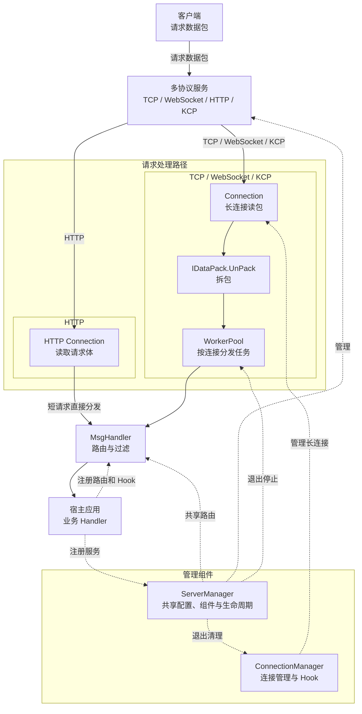

[//]: # (<p align="center">)

[//]: # (    )

[//]: # (</p>)

<h1 align="center">NETS</h1>

<p align="center">
  <strong>多协议 all-in-one 网络框架</strong><br/>
  一站式启动 TCP / WebSocket / HTTP / KCP 服务，专注路由、连接与生命周期管理<br />
  稳定、快速、安全
</p>

<div align="center">
  
  

[//]: # (   )

[//]: # (   )

[//]: # (   )

[//]: # (  )

[//]: # (  )
</div>

---

## ✨ 特性

| 特性        | 说明                                   |
|:----------|:-------------------------------------|
| **多协议统一** | TCP、WebSocket、HTTP、KCP 四种协议共用路由与连接管理 |
| **路由解耦**  | 通过 `msgId` 绑定消息工厂与业务处理函数，扩展性强        |
| **编解码可选** | JSON / Protobuf 一键切换，支持自定义 DataPack  |
| **连接管理**  | 分片哈希表存储，读写任务三协程分离，属性存取               |
| **限流控制**  | 基于 QPS 的连接限流，支持回调与自动断开               |
| **优雅退出**  | 监听系统信号，在进程退出前并行关闭所有服务与连接             |
| **高性能**   | 4核8G单台机器 CPS(每秒新建连接数) 可达 10,000+            |

---

## 📐 架构总览



- **实线**表示请求数据包的实际处理流向，**虚线**表示注册、管理和生命周期控制关系。
- TCP、WebSocket、KCP 请求经过 Connection、`IDataPack.UnPack` 和 WorkerPool，再进入统一消息处理链。
- HTTP 请求读取并解析 Body 后直接进入统一消息处理链，不经过长连接 WorkerPool。
- 消息处理链先执行限流与 Filter 校验，再查找路由、反序列化并调用宿主业务 Handler。

---

## 🔔 环境要求

- **Go ≥ 1.24.13**

---

## 🚀 快速上手

1. 安装

```bash
go get github.com/451008604/nets
```

2. 启动

```go
package main

import (
    "context"
    "log/slog"
    "os"
    "os/signal"
    "syscall"

    "github.com/451008604/nets"
    "google.golang.org/protobuf/proto"
    "google.golang.org/protobuf/types/known/wrapperspb"
)

func main() {
    conf := nets.GetServerConf()
    logger := slog.New(slog.NewJSONHandler(os.Stdout, nil)).With("service", "gateway")
    manager, err := nets.NewServerManager(&nets.CustomServer{AppConf: conf, Logger: logger})
    if err != nil {
        logger.Error("invalid configuration", "err", err)
        return
    }

    // 示例采用公开的生成消息类型；实际业务可替换为自己的 .proto 消息。
    manager.MsgHandler().AddSessionRouter(1001,
        func() proto.Message { return &wrapperspb.StringValue{} },
        func(conn nets.Session, message proto.Message) {
            conn.SendMsg(1001, message)
        },
    )

    ctx, cancel := signal.NotifyContext(context.Background(), os.Interrupt, syscall.SIGTERM)
    defer cancel()
    if err := manager.Run(ctx, manager.GetServerHTTP(), manager.GetServerKCP(),
        manager.GetServerTCP(), manager.GetServerWS()); err != nil {
        logger.Error("server failed", "err", err)
    }
}
```

3. [详细用法参考](./test/server/server.go)

---

## 实例、生命周期与兼容性

- TCP、KCP、WebSocket 和 HTTP 通过同一个 `ServerManager` 共享配置、路由、连接管理器、工作池和取消上下文；各协议实现自己的发送和接收。`ServerManager` 直接持有这些组件并统一管理生命周期。
- `NewServerManager(custom)` 校验并复制配置，传入 `nil` 使用默认配置；`Config()` 返回配置副本。`MsgHandler()`、`ConnManager()` 和 `WorkerPool()` 提供共享组件入口。需要隔离时可创建另一个管理器；跨实例共享自定义 DataPack 时需自行保证并发安全。
- `Run(ctx, servers...)` 阻塞至取消、`Stop()` 或服务错误，并等待服务退出、连接读写结束及已接收任务处理完成。`Stop()` 仅发出停止请求；`Shutdown(ctx)` 提供有期限的等待。停止后应创建新实例。
- 自定义服务可以实现 `ManagedServer.Serve(context.Context) error`，报告启动失败并响应取消。已有 `IServer.Start()` 仍可注册，但宿主必须保证它最终返回，框架才可完成等待。
- 长连接的 `DoTask` 按连接绑定的 worker 顺序执行，队列已满时立即返回 `false`，业务调用方必须处理拒绝；TCP / KCP / WebSocket 内建读路径仍等待队列空位，以保留背压与消息顺序。HTTP 的 `DoTask` 保持同步执行。
- 长连接关闭时先取消上下文、等待读循环及已准入任务结束，再调用 closed hook 并清空属性；已排队的协议任务在取消后跳过业务处理并回收消息。`Close()` 本身不等待任务，handler 中可以调用。业务任务应响应取消；opened / closed hook 不应同步调用等待自身结束的 `Shutdown` 或 `ConnManager.Wait`，触发停止可调用非阻塞 `Stop` / `Close`。
- 连接注册按每次准入的独立 token 清理，旧连接退出不会删除同 ID 的新连接。自定义连接值若无法安全比较，`Remove` 只请求其关闭，登记及容量在该次 `Open` 返回后释放；`Get` / `RangeConnections` 接口仍返回连接对象。
- 全局 `GetInstance*`、`GetServer*` 和 `SetCustomServer` 保留为默认实例的兼容入口。配置必须在第一次调用管理器或服务 getter 之前设置；`ConfigureDefault` 会返回校验或配置冻结错误，`SetCustomServer` 会记录错误。
- 只有兼容入口 `RegisterServer` 会监听进程信号；构造实例、获取管理器或调用 `Run` 不安装信号处理器。
- 新业务可以使用 `Session` 和 `AddSessionRouter`，避免依赖底层读写循环。`ContextSender.SendMsgWithContext` 可报告序列化、超限、取消和入队错误；长连接入队成功不代表已送达。旧 `SendMsg` 会记录发送错误。
- 旧 `IDataPack` 实现仍可使用；默认封包器还实现 `ErrorDataPack`，通过 `PackWithError` / `UnPackWithError` 返回错误。`UnPack` 允许只有包头的输入，正文由流式读取器补全。

## 协议与资源边界

- TCP / KCP 使用小端四字节包头：`uint16 msg_id + uint16 payload_length`。框架处理短读与短写，并在同一连接内按提交顺序执行消息。KCP 服务端启用流模式。
- WebSocket 使用二进制消息；每个 WebSocket 消息的总长度上限为 `MaxPackSize + 包头长度`，包括聚合在同一消息中的多个包。
- `ProtocolIsJson=true` 使用 Go `encoding/json` 编解码业务消息，`false` 使用 Protobuf。HTTP 请求封套是 `Message{msg_id, data}`；JSON 下 `data` 使用 base64，Protobuf 字段定义见 [envelope.proto](./envelope.proto)。
- 四个协议均支持成对配置 `TLSCertPath` / `TLSKeyPath`；未配置时保留明文模式。TCP 使用标准 TLS，KCP 在可靠有序的流上运行 TLS，HTTP / WebSocket 使用 HTTPS / WSS。
- HTTP 的非零消息 ID 响应保留二进制封包格式；消息 ID 为 0 时发送原始业务序列化结果。只有显式注册路由 0 才接受原始请求体。HTTP 任务同步执行，请求结束后连接上下文关闭，异步响应发送会返回错误。
- `MaxConn` 是单个 ServerManager 内 HTTP 在途请求与 TCP / KCP / WebSocket 长连接共享的原子准入上限。`MaxPackSize` 限制收发正文，最大值为 65535。
- `MaxFlowSecond` 是每个连接的固定时间窗口限流：-1 关闭限流，0 拒绝全部消息。HTTP 每个请求对应一个连接对象，持续的客户端限流应由网关或业务 Filter 实现。
- 工作池每个任务独立恢复 panic。`Stop()` 拒绝新任务并处理完已接收队列；业务应响应上下文取消。公开 `Submit` / `SubmitWithWorker` 仍等待队列空位；不要在任务中向同一 worker 的满队列做阻塞提交，也不要在池内任务调用同一个工作池的阻塞 `Stop()`，可调用 ServerManager 的非阻塞 `Stop()`。

## TLS 配置与客户端

```go
conf := nets.GetServerConf()
conf.ServerTCP.TLSCertPath, conf.ServerTCP.TLSKeyPath = "server-cert.pem", "server-key.pem"
conf.ServerKCP.TLSCertPath, conf.ServerKCP.TLSKeyPath = "server-cert.pem", "server-key.pem"
manager, err := nets.NewServerManager(&nets.CustomServer{AppConf: conf})
if err != nil {
    return err
}
return manager.Run(ctx, manager.GetServerTCP(), manager.GetServerKCP())
```

TCP / KCP 启动时加载并校验证书与私钥，失败通过 `Run` 返回并停止同管理器的其他服务；最低支持 TLS 1.2，可协商 TLS 1.3。只配置证书或私钥会在构造时失败，端口为 0 的服务不监听或加载证书文件。

每个握手先占用共享 `MaxConn` 预算，在独立连接协程完成，不阻塞接受其他客户端。握手受 `ConnRWTimeOut` 秒的总超时及连接上下文取消控制，成功后才执行 opened hook、启动业务读写。握手失败释放容量，不调用连接 hook。`Close` / 停止服务直接关闭底层传输以解除等待，不等待客户端读取 TLS `close_notify`。

TCP 客户端可以使用 `tls.DialWithDialer`；KCP 客户端先用 `kcp.DialWithOptions` 创建会话、启用 `SetStreamMode(true)`，再用 `tls.Client(session, config)` 和有期限的 `HandshakeContext`。客户端应通过 `RootCAs` 和 `ServerName` 校验证书；KCP 的服务器名需要显式设置为证书中的主机名或 IP。KCP 的此模式是 **TLS over KCP**，加密业务字节流，KCP/UDP 外层头仍保留，不是 DTLS。

## 验证

```bash
go test -race -cover -timeout=60s ./...
go vet ./...
(cd test/server && go build -o /tmp/nets-server ./...)
(cd test/client && go build -o /tmp/nets-client ./...)
```

回归测试覆盖分段读取、对象池所有权、JSON / Protobuf 实例隔离、同一管理器下四种协议收发与统一关闭、工作池 panic 与队列关闭、共享容量、启动失败以及 HTTP / 服务退出等待。

---

## 🔧 分布式压测

性能测试工具位于 `test` 目录，采用 `docker compose` 编排 `1个server + N个client` 模拟海量客户端并发测试。具体测试配置项位于 [docker-compose.yml](./test/docker-compose.yml)  
进入 `test` 目录
- 执行 `sh run_server.sh` 启动服务端，再执行 `sh run_client.sh` 启动客户端
- 执行 `sh run_client.sh` 单独启动客户端

```shell
# 查看内存占用
go tool pprof -http=:8080 http://localhost:16060/debug/pprof/heap

# 查看 server 日志
docker compose logs server -f
```

---

## 📄 许可证

[Apache-2.0 License](LICENSE)
