[//]: # (<p align="center">)

[//]: # (    )

[//]: # (</p>)

<h1 align="center">NETS</h1>

<p align="center">
  <strong>多协议 all-in-one 网络框架</strong><br/>
  一站式启动 TCP / WebSocket / HTTP / KCP 服务，专注路由、连接与生命周期管理<br />
  稳定、快速、安全
</p>

<div align="center">
  
  

[//]: # (   )

[//]: # (   )

[//]: # (   )

[//]: # (  )

[//]: # (  )
</div>

---

## ✨ 特性

| 特性        | 说明                                   |
|:----------|:-------------------------------------|
| **多协议统一** | TCP、WebSocket、HTTP、KCP 四种协议共用路由与连接管理 |
| **路由解耦**  | 通过 `msgId` 绑定消息工厂与业务处理函数，扩展性强        |
| **编解码可选** | JSON / Protobuf 一键切换，支持自定义 DataPack  |
| **连接管理**  | 分片哈希表存储，读写任务三协程分离，属性存取               |
| **限流控制**  | 基于 QPS 的连接限流，支持回调与自动断开               |
| **优雅退出**  | 监听系统信号，在进程退出前并行关闭所有服务与连接             |
| **高性能**   | 4核8G单台机器 CPS(每秒新建连接数) 可达 10,000+            |

---

## 📐 架构总览

```mermaid
flowchart LR
    Client["① 客户端<br/>发送请求数据包"]
    Protocol["② 多协议服务<br/>TCP · WebSocket · HTTP · KCP"]

    LongConn["③ 长连接 Connection<br/>TCP · WebSocket · KCP"]
    HTTPConn["③ HTTP Connection<br/>读取请求 Body"]

    Unpack["④ IDataPack.UnPack<br/>读取 msgId、dataLen 和消息体"]
    HTTPParse["④ HTTP 协议解析<br/>JSON / Protobuf / 原始 Body"]
    Workers["⑤ WorkerPool<br/>按 connectionId 投递到固定 Worker"]
    MsgHandler["⑥ readerTaskHandler + MsgHandler<br/>路由查找 → 反序列化 → 限流 → Filter"]
    Host["⑦ 宿主应用<br/>执行已注册的业务 Handler"]

    Client -->|"请求数据包"| Protocol
    Protocol -->|"TCP / WebSocket / KCP"| LongConn
    Protocol -->|"HTTP"| HTTPConn

    LongConn -->|"读取字节流或二进制帧"| Unpack
    Unpack -->|"IMessage"| Workers
    Workers -->|"同一连接顺序执行"| MsgHandler

    HTTPConn --> HTTPParse
    HTTPParse -->|"HTTP 短请求直接分发"| MsgHandler

    MsgHandler -->|"router.RunHandler"| Host

    ServerManager["ServerManager<br/>服务启动、停止与优雅退出"]
    ConnManager["ConnectionManager<br/>连接集合与生命周期 Hook"]

    Host -.->|"注册并启动服务"| ServerManager
    Host -.->|"注册路由、Filter、Hook"| MsgHandler
    ServerManager -.->|"管理协议服务"| Protocol
    ServerManager -.->|"退出时清理"| ConnManager
    ServerManager -.->|"退出时停止"| Workers
    ConnManager -.->|"Add / Remove / Open / Close"| LongConn
    ConnManager -.->|"Open / Close Hook"| HTTPConn

    classDef packet fill:#dbeafe,stroke:#2563eb,color:#172554,stroke-width:2px
    classDef process fill:#ecfdf5,stroke:#059669,color:#064e3b
    classDef manager fill:#fff7ed,stroke:#ea580c,color:#7c2d12
    classDef host fill:#f5f3ff,stroke:#7c3aed,color:#3b0764,stroke-width:2px

    class Client packet
    class Protocol,LongConn,HTTPConn,Unpack,HTTPParse,Workers,MsgHandler process
    class ServerManager,ConnManager manager
    class Host host
```



- **实线**表示请求数据包的实际处理流向，**虚线**表示注册、管理和生命周期控制关系。
- TCP、WebSocket、KCP 请求经过 Connection、`IDataPack.UnPack` 和 WorkerPool，再进入统一消息处理链。
- HTTP 请求读取并解析 Body 后直接进入统一消息处理链，不经过长连接 WorkerPool。
- `MsgHandler` 完成路由查找、协议反序列化、限流和 Filter 校验，最后调用宿主注册的业务 Handler。

---

## 🔔 环境要求

- **Go ≥ 1.21.1**

---

## 🚀 快速上手

1. 安装

```bash
go get github.com/451008604/nets
```

2. 启动

```go
package main

import (
    "github.com/451008604/nets"
    "github.com/451008604/nets/internal"
    "google.golang.org/protobuf/proto"
	"log/slog"
	"os"
)

func main() {
	// 可选：注入宿主项目的 slog.Logger，SDK 会保留 Handler、级别和 With 属性。
	conf := nets.GetServerConf()
	logger := slog.New(slog.NewJSONHandler(os.Stdout, nil)).With("service", "game-gateway")
	nets.SetCustomServer(&nets.CustomServer{AppConf: conf, Logger: logger})

    // 1. 注册路由
    nets.GetInstanceMsgHandler().AddRouter(int32(internal.Test_MsgId_Test_Echo), func() proto.Message { return &internal.Test_EchoRequest{} }, func(conn nets.IConnection, message proto.Message) {
        // 获取请求数据
        msgReq, _ := message.(*internal.Test_EchoRequest)
        // 构造响应数据
        msgRes := &internal.Test_EchoResponse{}
        // 业务处理完毕发送响应数据
        defer conn.SendMsg(int32(internal.Test_MsgId_Test_Echo), msgRes)

        // ...处理逻辑，并设置响应数据...
        msgRes.Message = msgReq.GetMessage()
    })

    // 2. 启动服务(阻塞主协程) 
    nets.GetInstanceServerManager().RegisterServer(nets.GetServerHTTP(), nets.GetServerKCP(), nets.GetServerTCP(), nets.GetServerWS())
}
```

3. [详细用法参考](./test/server/server.go)

---

## 🔧 分布式压测

性能测试工具位于 `test` 目录，采用 `docker compose` 编排 `1个server + N个client` 模拟海量客户端并发测试。具体测试配置项位于 [docker-compose.yml](./test/docker-compose.yml)  
进入 `test` 目录
- 执行 `sh run_all.sh` 启动完整性能测试
- 执行 `sh run_client.sh` 单独启动客户端

```shell
# 查看内存占用
go tool pprof -http=:8080 http://localhost:16060/debug/pprof/heap

# 查看 server 日志
docker compose logs server -f
```

---

## 📄 许可证

[Apache-2.0 License](LICENSE)
